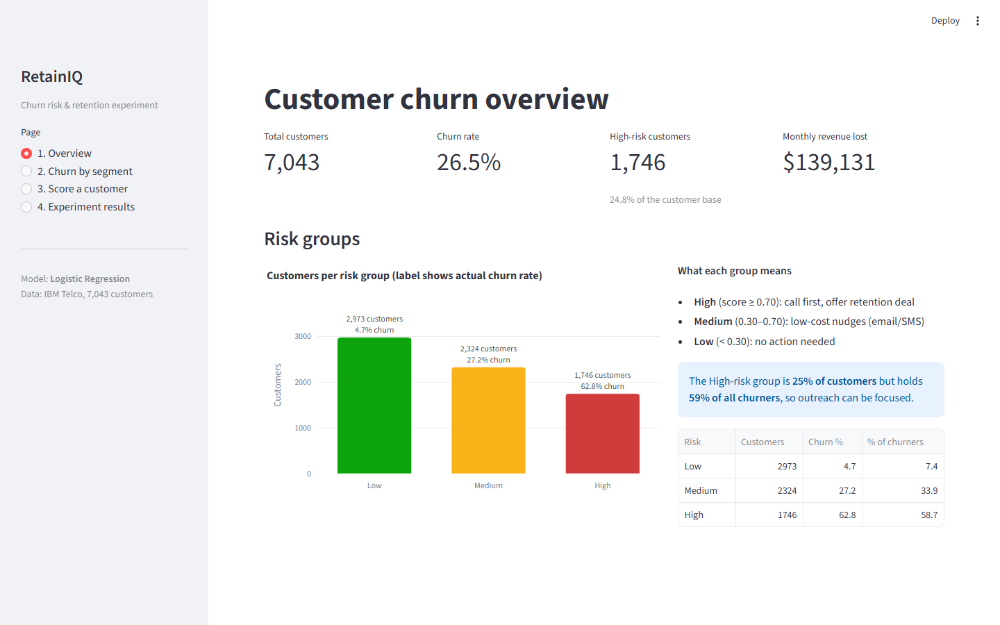
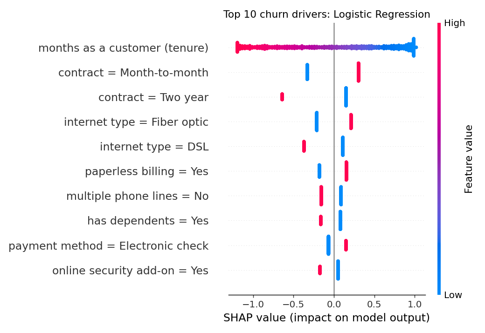
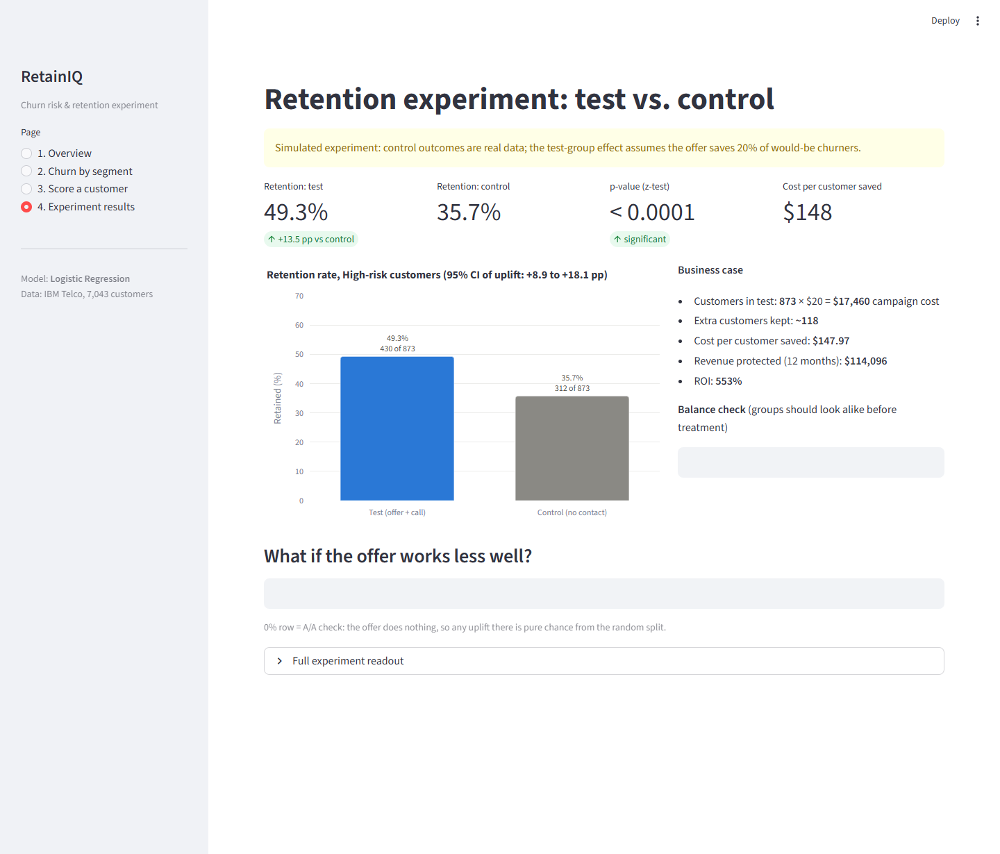
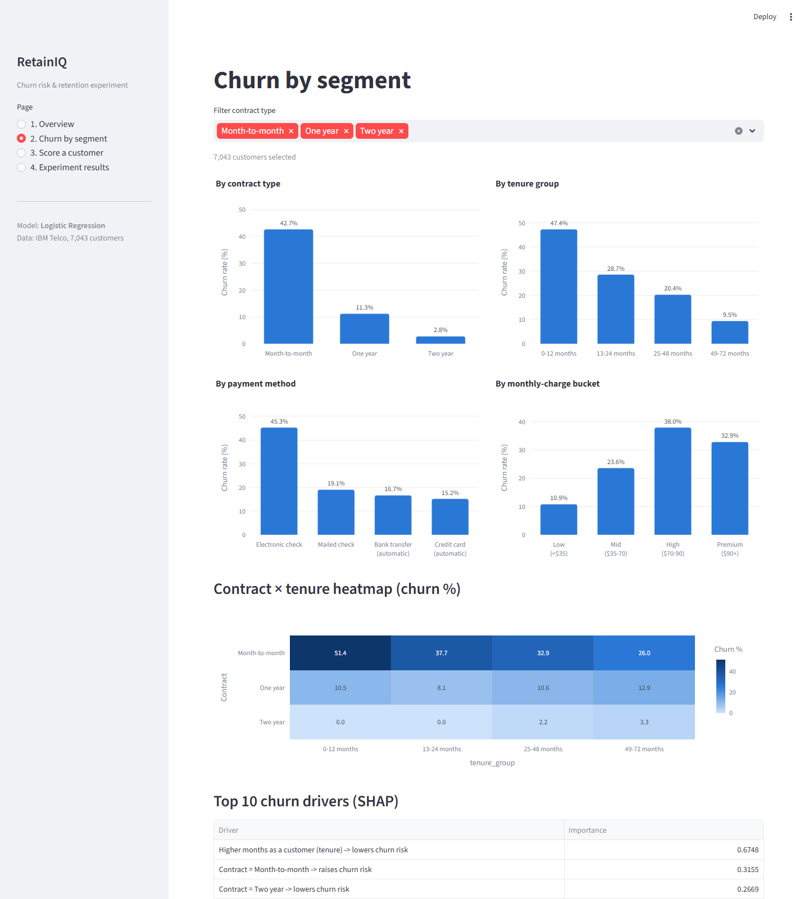
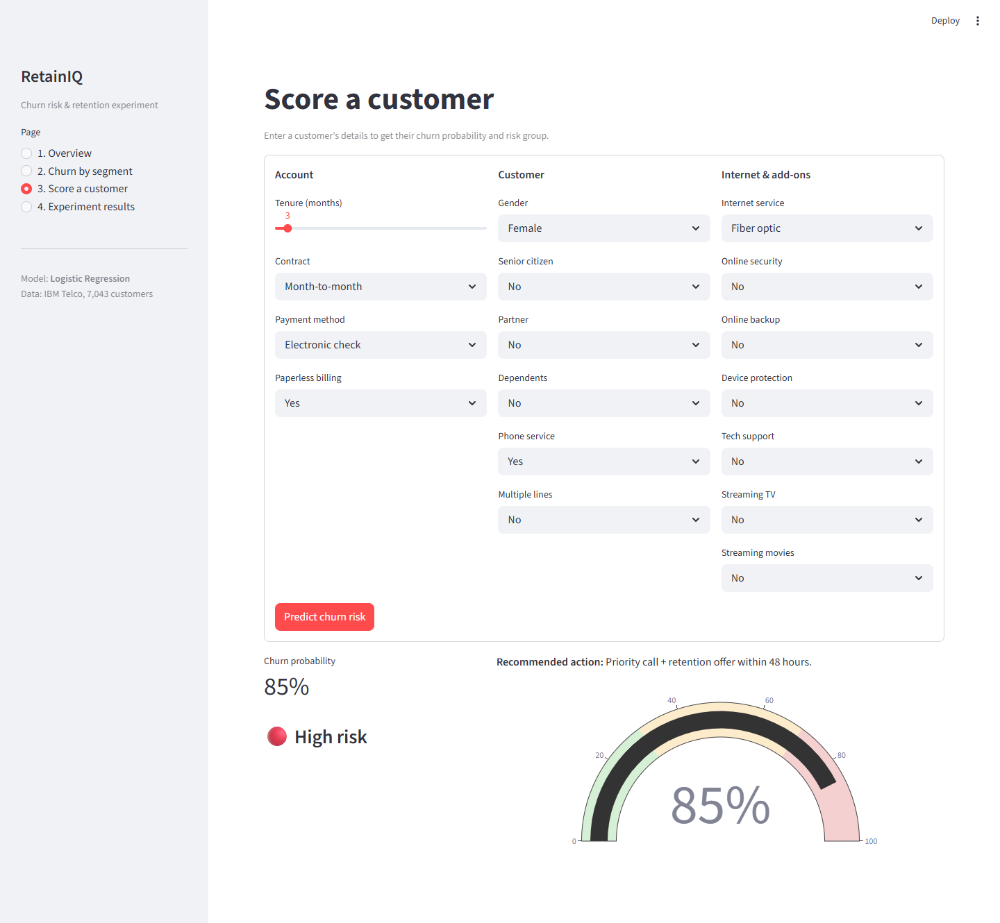

# RetainIQ: Churn Risk Scoring & Retention Experiment

**Predict which customers are about to leave, rank them by risk, and prove (with a test vs. control
experiment) whether a retention campaign is worth its cost.**

[](https://retainiq-dashboard.streamlit.app/)

**Live dashboard: [retainiq-dashboard.streamlit.app](https://retainiq-dashboard.streamlit.app/)**

Built on the IBM Telco Customer Churn dataset. The same playbook applies to fintech and collections:
replace "churn" with "roll into delinquency" and "retention offer" with "reminder call / payment plan".



---

## 1. Business problem

A subscription business loses **26.5% of its customers** and about **$139K of monthly revenue** to churn.
The retention team cannot call everyone, so it needs answers to three questions:

1. **Who** is most likely to leave? (risk scoring)
2. **Where** should limited outreach go? (Low / Medium / High risk buckets)
3. **Does** outreach actually work, and what does each saved customer cost? (A/B experiment)

| Collections analogy | RetainIQ |
|---|---|
| Probability of a customer missing payment | Churn probability |
| Risk buckets for prioritising agent calls | Low / Medium / High risk groups |
| Pilot a new call script on a test group vs. control | Retention offer: test vs. control |
| Cost per rupee recovered | Cost per customer saved |

## 2. Data

* **Source:** [IBM Telco Customer Churn (Kaggle)](https://www.kaggle.com/datasets/blastchar/telco-customer-churn)
* **Raw shape:** **7,043 rows × 21 columns** (one row per customer)
* **Target:** `Churn` (Yes/No): left in the last month. 1,869 churners (26.5%).

| Data-quality check | Before | After |
|---|---|---|
| Rows | 7,043 | 7,043 |
| Columns | 21 | 24 (+ `tenure_group`, `charge_bucket`, `num_addons`) |
| Missing / blank values | 11 (blank `TotalCharges`) | 0 |
| `TotalCharges` type | text (object) | number (float) |
| `SeniorCitizen` encoding | 0/1 (inconsistent) | Yes/No |
| `Churn` type | Yes/No text | 1/0 integer |
| Duplicate rows / customer IDs | 0 / 0 | 0 / 0 |

All 11 blank `TotalCharges` belong to customers with `tenure = 0` (signed up, never billed), so they
were set to **0**, not filled with an average.

## 3. Approach

```
raw CSV ──► 1. Clean (pandas) ──► 2. SQL analysis (SQLite, 8 queries)
                     │
                     ▼
          4. Train 4 models ──► pick best (CV F2) ──► SHAP top-10 drivers
                     │
                     ▼
          3. Score every customer (out-of-fold) ──► Low / Medium / High risk
                     │
                     ├──► 5. Simulated A/B test on High-risk ──► readout
                     ├──► 6. Streamlit dashboard (4 pages)
                     └──► 7. Excel MIS (pivot + XLOOKUP)
```

## 4. Results

### SQL highlights ([sql/churn_analysis.sql](sql/churn_analysis.sql), [full output](reports/sql_results.md))

| Segment | Churn rate |
|---|---|
| Month-to-month contract | **42.7%** (vs. 11.3% one-year, 2.8% two-year) |
| First 12 months of tenure | **47.4%** (vs. 9.5% after 4+ years) |
| Electronic-check payers | **45.3%** (vs. 15–19% for other methods) |
| Month-to-month + Fiber + E-check (1,307 customers) | **60.4%**: the single biggest hotspot |

### Model comparison (held-out test set, 1,409 customers)

| Model | Accuracy | Precision | Recall | F1 | ROC-AUC | 5-fold CV F2 (train) |
|---|---|---|---|---|---|---|
| **Logistic Regression** ✅ | 0.742 | 0.509 | 0.778 | 0.615 | 0.839 | **0.718 ± 0.027** |
| Random Forest | 0.754 | 0.525 | 0.775 | 0.626 | 0.839 | 0.717 ± 0.020 |
| XGBoost | 0.746 | 0.514 | 0.786 | 0.622 | 0.843 | 0.708 ± 0.025 |
| LightGBM | 0.752 | 0.521 | 0.781 | 0.625 | 0.844 | 0.706 ± 0.026 |

**Why Logistic Regression?** Missing a churner costs more than a wasted call, so models were ranked
on **F2** (recall weighted 2× over precision) using cross-validation on training data only. Logistic
Regression ranked first. All four models sit within one standard deviation of each other, so the tie
goes to the **simplest, most explainable** model: each factor has one clear weight that a credit or
compliance reviewer can audit. It catches **78% of churners** in the test set.

### Top 10 churn drivers (SHAP, plain English)



1. Longer tenure → **lowers** churn risk (strongest factor)
2. Month-to-month contract → raises risk
3. Two-year contract → lowers risk
4. Fiber-optic internet → raises risk
5. DSL internet → lowers risk
6. Paperless billing → raises risk
7. Single phone line → lowers risk
8. Has dependents → lowers risk
9. Pays by electronic check → raises risk
10. Has online-security add-on → lowers risk

### Risk segmentation (scores are out-of-fold: each customer is scored by a model that never saw them)

| Risk group | Rule | Customers | % of base | Actual churn rate | % of all churners |
|---|---|---|---|---|---|
| Low | score < 0.30 | 2,973 | 42.2% | 4.7% | 7.4% |
| Medium | 0.30 – 0.70 | 2,324 | 33.0% | 27.2% | 33.9% |
| **High** | ≥ 0.70 | **1,746** | **24.8%** | **62.8%** | **58.7%** |

**A quarter of customers hold 59% of all churners**, so the call team should focus there.

### Retention experiment ([full readout](reports/experiment_readout.md))

High-risk customers split 50/50 at random. Test gets an offer + reminder call (≈$20 each), control gets nothing.
Control outcomes are the real data; the offer's effect is an **assumption** (saves 20% of would-be churners).

| | Test | Control |
|---|---|---|
| Customers | 873 | 873 |
| Retention rate | **49.3%** | **35.7%** |

* **Uplift +13.5 pp** (95% CI +8.9 to +18.1), **z = 5.71, p < 0.0001**: significant
* **Cost per customer saved: $148** · revenue protected (12 mo): $114K · ROI 553%
* A/A check (offer does nothing): +2.9 pp, p = 0.22 → not significant, as it should be
* Still significant if the offer only saves 5% of churners (p = 0.02)
* **Decision:** roll out to High-risk customers, keep a 10% holdout to keep measuring



## 5. Dashboard

| Page | What it shows |
|---|---|
| 1. Overview | KPIs: customers, churn rate, high-risk count, revenue lost; risk-group chart |
| 2. Churn by segment | Churn by contract, tenure, payment, charges; contract × tenure heatmap; SHAP drivers |
| 3. Score a customer | Enter details → churn probability, risk group, recommended action |
| 4. Experiment results | Test vs. control, p-value, cost per save, sensitivity table |

<p float="left">
  
  
</p>

## 6. Excel MIS ([reports/RetainIQ_MIS.xlsx](reports/RetainIQ_MIS.xlsx))

| Tab | Contents |
|---|---|
| Summary | KPIs and risk-group table, all live formulas (`COUNTIF`, `SUMIFS`, `AVERAGEIFS`) |
| Pivot | Churn % and customer count by **Contract × Tenure group** (`AVERAGEIFS`/`COUNTIFS`, colour scale) |
| Lookup | Type a customer ID → **`XLOOKUP`** returns risk group, score, contract, tenure; plus a batch lookup |
| Data | 7,043 scored customers (source for every formula) |

Opens in Excel 365 or Google Sheets (File → Import). Formula results were checked against pandas.

## 7. Project structure

```
RetainIQ/
├── app/streamlit_app.py        # 4-page dashboard
├── data/
│   ├── raw/telco_churn.csv     # original Kaggle file
│   └── processed/              # cleaned + scored CSVs, SQLite DB (generated)
├── docs/WALKTHROUGH.md         # step-by-step explanation + interview Q&A
├── models/best_model.joblib    # trained pipeline (generated)
├── reports/                    # model table, SQL output, readout, Excel MIS, figures
├── scripts/run_pipeline.py     # runs every step end to end
├── sql/churn_analysis.sql      # 8 analysis queries
├── src/retainiq/               # cleaning, sql, modeling, segmentation, experiment, excel
├── tests/test_retainiq.py      # 7 tests
└── requirements.txt
```

## 8. How to run

```bash
git clone https://github.com/AditiShindadkar/RetainIQ.git
cd RetainIQ
python -m venv .venv && .venv\Scripts\activate      # macOS/Linux: source .venv/bin/activate
pip install -r requirements.txt

python scripts/run_pipeline.py      # ~1 min: cleans, queries, trains, scores, runs experiment, writes Excel
pytest -q                           # 7 tests
streamlit run app/streamlit_app.py  # open http://localhost:8501
```

All business assumptions (risk cut-offs, offer cost, assumed uplift) live in
[src/retainiq/config.py](src/retainiq/config.py).

## 9. Limitations & next steps

* The experiment is **simulated**: the uplift is assumed. A live pilot is needed to measure the true effect.
* Churn scores come from class-balanced models, so they rank risk well but run higher than true
  probabilities. Calibration (Platt / isotonic) would fix that if exact probabilities were needed.
* One snapshot in time: no behaviour trends (e.g. falling usage, late payments), which would add strong signals.
* Next: tune the cut-off for the call team's capacity, add uplift modelling (who responds to the offer,
  not just who is at risk), and test cheaper channels (SMS/email) against calls.
